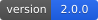
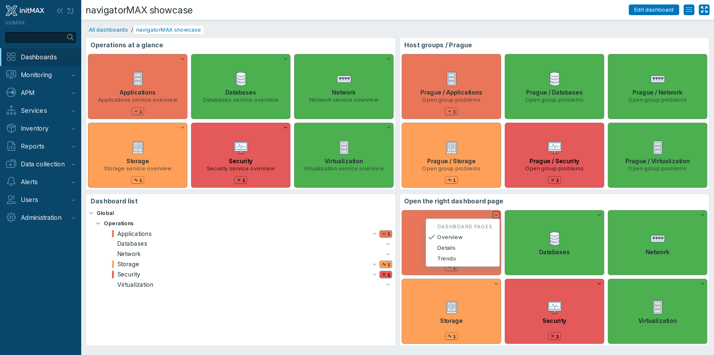
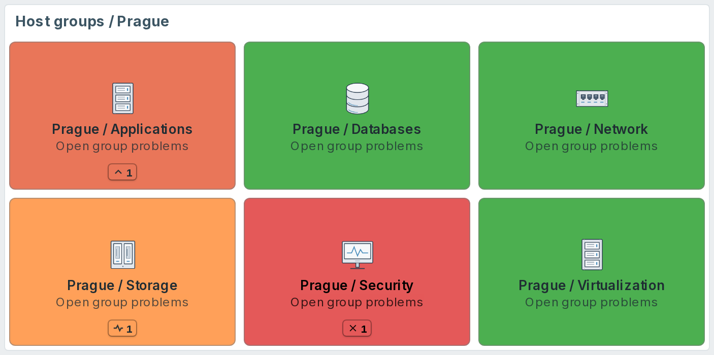
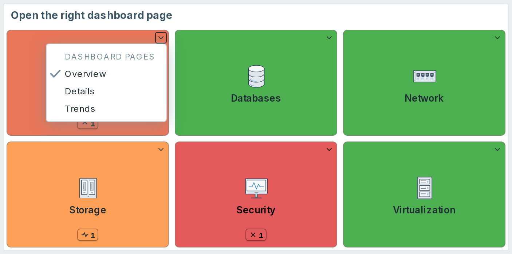
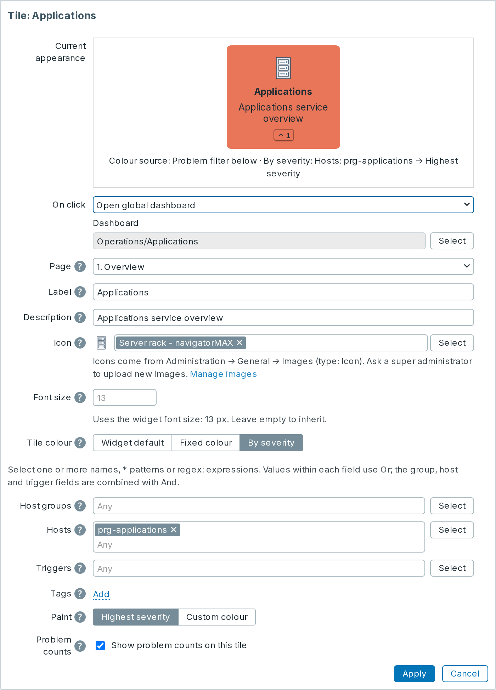
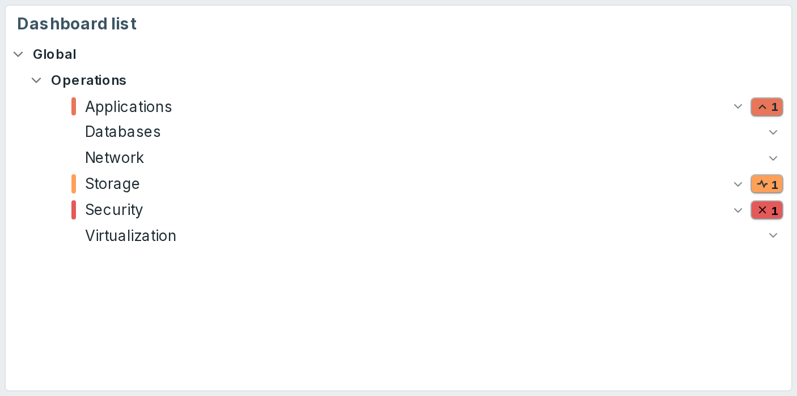
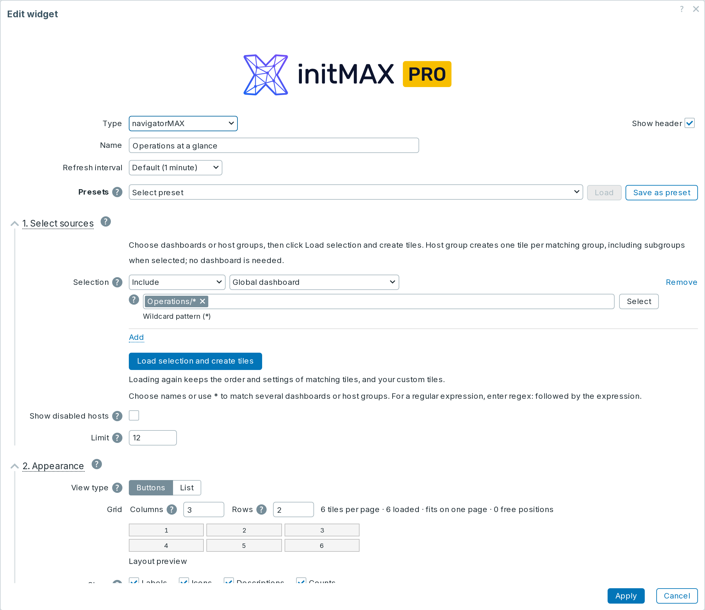

<h1>navigatorMAX</h1>

developed and maintained by

and community

<strong>A navigation widget for Zabbix dashboards.</strong> 
Build a navigation dashboard from a selection of dashboards or host groups, then arrange the generated tiles and add your own links.

<a href="#what-you-can-build"><strong>Features</strong></a> &nbsp;·&nbsp;
<a href="#examples"><strong>Examples</strong></a> &nbsp;·&nbsp;
<a href="#configuration"><strong>Configuration</strong></a> &nbsp;·&nbsp;
<a href="#install"><strong>Install</strong></a> &nbsp;·&nbsp;
<a href="#free-vs-pro"><strong>FREE vs PRO</strong></a> &nbsp;·&nbsp;
<a href="https://portal.initmax.com"><strong>Portal</strong></a> &nbsp;·&nbsp;
<a href="https://www.initmax.com/wiki/navigatormax/"><strong>Docs</strong></a>

 

---

## Why navigatorMAX

A team may have dozens of dashboards and a hierarchy of host groups for its sites and equipment. **navigatorMAX** creates navigation tiles from that selection in one step. Arrange the tiles, choose their appearance and keep the dashboards, problem views and custom URLs your team needs in one place.

The widget reads the data available to the current Zabbix user and follows the configured refresh interval. It adds no monitoring agent or polling service; its configuration stays in Zabbix.

## What you can build

<table>
<tr>
<td width="33%"><b>A landing dashboard</b> <small>One tile per global dashboard, grouped by the slash in its name, so a new colleague can find their way without asking.</small></td>
<td width="33%"><b>A per-host drill-down</b> <small>Every host's own template dashboards as tiles, so an on-call engineer jumps from the alert to the host's graphs in one click.</small></td>
<td width="33%"><b>A site and equipment navigator</b> PRO <small>One tile per host group, including its subgroups when requested. Open each group's problems without creating a dashboard for it first.</small></td>
</tr>
<tr>
<td><b>A link bar</b> PRO <small>Custom URLs alongside dashboards - the runbook, the ticket queue, the status page - opening in the same window or a new tab.</small></td>
<td><b>A status wall</b> <small>Tiles coloured by the highest problem severity on the host behind them, so the wall itself shows where to look.</small></td>
<td><b>A shared house style</b> PRO <small>Presets kept in the module configuration, so every navigatorMAX on every dashboard offers the same ready-made setups.</small></td>
</tr>
</table>

## Examples

<table>
<tr>
<td width="50%" align="center" valign="top"> <small><b>Host groups (PRO)</b> - create tiles from a site hierarchy, without extra dashboards</small></td>
<td width="50%" align="center" valign="top"> <small><b>Dashboard pages</b> - open the page you need directly from a tile</small></td>
</tr>
<tr>
<td width="50%" align="center" valign="top"> <small><b>Individual tiles (PRO)</b> - customise a destination and its appearance</small></td>
<td width="50%" align="center" valign="top"> <small><b>List view</b> - browse related destinations in a compact tree</small></td>
</tr>
</table>

## Configuration

The form follows three steps:

1. **Select sources.** Add **Include** rows for the dashboards you want and **Exclude** rows for matches to leave out. Both editions offer global dashboards and host dashboards selected by host name. PRO adds template-based selection, host selection by tag or group, and direct host-group tiles. Click **Load selection and create tiles** to populate the tile list. Changing a selection shows a warning until it has been loaded again.
2. **Appearance.** Choose **Buttons** for a grid or **List** for a collapsible tree. Set the grid size, labels, icons, descriptions and counts, then adjust font size, icon size, tile spacing, corner radius and colours. Light and dark examples show how the selected colours look in each Zabbix theme.
3. **Arrange tiles.** Search, reorder and edit the generated tiles. In PRO, add custom tiles and choose their destination, label, description, icon and colour. A dashboard's page selector sits directly below the selected dashboard; dashboards with several pages also have a page menu on the rendered tile.

Loading the selection again keeps the custom settings of matching tiles and retains manually added tiles, including their custom URLs. It refreshes the generated selection; it does not reset each tile's appearance or destination. Click **Apply**, then save the dashboard when you are ready.

**Matching names**

| Input | Meaning |
|:---|:---|
| A selected name | That exact dashboard, host or host group. |
| `Operations*` | Names starting with `Operations`. `*` also matches `/`, so a host-group pattern such as `s4/000/network/*` can match descendants at any depth. |
| `regex:^Operations/EU$` | An explicit regular expression (PRO). The field shows which kind of matching it uses; an ambiguous expression is not silently converted. |

For a group hierarchy in PRO, select **Host group**, enter `s4/000/network` and enable **Include subgroups**. Each matching group becomes its own tile linking to its Problems view. No dashboard is required, and the parent path may simply be a folder for existing descendant groups. An exact name without **Include subgroups** selects only that group.

Enable **Colour by host problems** to colour host dashboard tiles by their host's highest current problem severity, and enable **Counts** to show per-severity totals. These switches and the widget-wide severity/suppression settings work in both editions. In PRO, a tile can also use a fixed colour or its own problem filter. A custom URL has no monitoring data of its own; choose **By severity** and select host groups, hosts, triggers or tags when its colour or counts should reflect Zabbix problems. The group, host and trigger fields accept several selected names or patterns. Severity colours come from Zabbix's global settings, and changing those colours affects the whole frontend. Image uploads and shared preset management also follow Zabbix administrator permissions.

**Live descriptions** work in both editions. Put an expression such as `Free space: {?last(/server/vfs.fs.size[/,free])}` in a tile description. Use the technical host name and item key. The native Zabbix resolver supplies current values and units in both the tile and editor preview, respecting the viewer's item permissions. The expression stays saved and is evaluated on refresh; unavailable items show `*UNKNOWN*`. Supported functions and syntax follow the installed Zabbix map-label expression resolver.

**Presets** store source selections and common display settings, not the individual tile overrides. Both editions include **Host dashboards and problems**, a starter that loads accessible host dashboards into a 4 × 2 grid with live host colours and counts (up to 100 tiles). Choose a preset and click **Load**; confirm replacement if prompted, and the widget creates the tiles automatically. Existing matching tile overrides are kept. PRO adds more built-in presets and lets a super administrator save setups to the shared preset list.

The FREE edition includes global and host dashboard selection with Include/Exclude and wildcard matching, plus automatic host problem colours and counts. Global dashboards have no destination host; their default tile colour is an appearance setting, not an indication that everything is healthy. Automatic host state checks up to 10,000 matching problem events per refresh. If more events exist or the lookup fails, affected tiles show a neutral unavailable state with a warning and a link to Problems; incomplete totals are not shown. PRO controls stay visible with a padlock and upgrade hint. Both editions respect the viewer's Zabbix permissions: a shared dashboard does not grant access to the hosts, host groups or other dashboards behind its tiles. Empty results and tile limits are explained in the widget.

## Install

navigatorMAX ships as GPG-signed `deb` and `rpm` packages from initMAX's own repository, in a FREE and a PRO build.

**Easiest way - the guided installer on the Portal.** The installer renders the exact commands for your distribution, handles the PRO token and takes feedback:

**[Open the guided installer on the Portal](https://portal.initmax.com/catalog/zabbix-navigatormax#how-to-install)**

When the frontend database is reachable, the package registers and enables the widget automatically. It preserves an existing administrator-disabled status and saved settings. If installation reports a manual action, open **Administration -> General -> Modules**, scan the directory and enable navigatorMAX. Native packages also switch to the compatible module after a Zabbix frontend upgrade or rollback.

## FREE vs PRO

| Feature | FREE | PRO |
|:---|:---:|:---:|
| Global dashboard targets | ✅ | ✅ |
| Collapsible tree or button-grid view | ✅ | ✅ |
| Include/Exclude selection and bulk tile creation | ✅ | ✅ |
| Wildcard target matching | ✅ | ✅ |
| Hierarchy from slash-separated dashboard names | ✅ | ✅ |
| Dashboard pages and page menus | ✅ | ✅ |
| Reorder tiles and edit their labels and descriptions | ✅ | ✅ |
| Show or hide labels, icons and descriptions | ✅ | ✅ |
| Widget background, default tile colour and default icon | ✅ | ✅ |
| Tile cap with a showing-first-N notice | ✅ | ✅ |
| Localised into all 27 Zabbix display languages | ✅ | ✅ |
| High availability ready | ✅ | ✅ |
| Host dashboard targets | ✅ | ✅ |
| Automatic colour by destination host severity | ✅ | ✅ |
| Per-severity host problem counts | ✅ | ✅ |
| Widget-wide severity and suppression settings | ✅ | ✅ |
| Built-in host dashboard starter preset | ✅ | ✅ |
| Template dashboard targets | ❌ | ✅ |
| Custom URL tiles with same-window or new-tab opening | ❌ | ✅ |
| Host targets selected by tag, with all six tag operators | ❌ | ✅ |
| Host group tiles, with optional subgroups | ❌ | ✅ |
| Regular-expression target matching | ❌ | ✅ |
| Per-tile colour override | ❌ | ✅ |
| Per-tile icon override | ❌ | ✅ |
| Problem filters with multiple host groups, hosts or triggers | ❌ | ✅ |
| Additional presets for selections and display settings | ❌ | ✅ |
| Operator-managed preset list in the module configuration | ❌ | ✅ |
| Licence | AGPLv3 | [Commercial](./LICENSE-PRO.md) |

PRO is a one-time purchase and stays yours for the lifetime of the product.

## Requirements

Zabbix 8.0 compatibility is tested on 8.0.0rc2; the stable upstream release is pending.

| | |
|:---|:---|
| **Zabbix** | 6.0, 6.2, 6.4, 7.0, 7.2, 7.4 and 8.0 |
| **PHP** | 7.4 or newer |
| **OS families** | Debian and Ubuntu (`deb`), RHEL, Rocky, Alma and openSUSE (`rpm`) |
| **Editions** | FREE (AGPLv3) and PRO (commercial, one-time purchase) |
| **Languages** | All 27 Zabbix display languages - the widget follows each user's own language setting |
| **High availability** | Ready. No server-side component and no local state; install it on every frontend node of an HA cluster and any node can serve it |

## Support and links

- Documentation: [initMAX wiki](https://www.initmax.com/wiki/navigatormax/)
- Product page: [navigatorMAX](https://www.initmax.com/product/navigatormax/)
- Packages and licences: [initMAX Portal](https://portal.initmax.com)
- Source code (FREE, AGPLv3) - included in every package and published as a [source archive](https://repo.initmax.com/zabbix/free/zip/navigatormax/) on repo.initmax.com
- Support: [support@initmax.com](mailto:support@initmax.com)

---

<small>
FREE: <a href="https://www.gnu.org/licenses/agpl-3.0.html">AGPLv3</a> &nbsp;·&nbsp;
PRO: <a href="./LICENSE-PRO.md">commercial</a> &nbsp;·&nbsp;
(c) 2021-2026 initMAX s.r.o.
</small>

